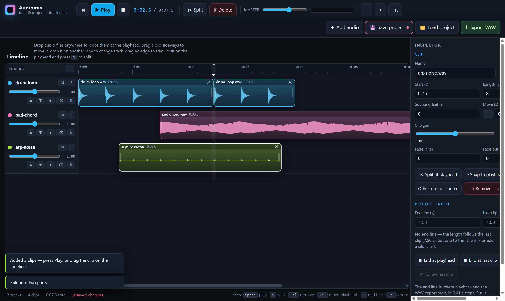
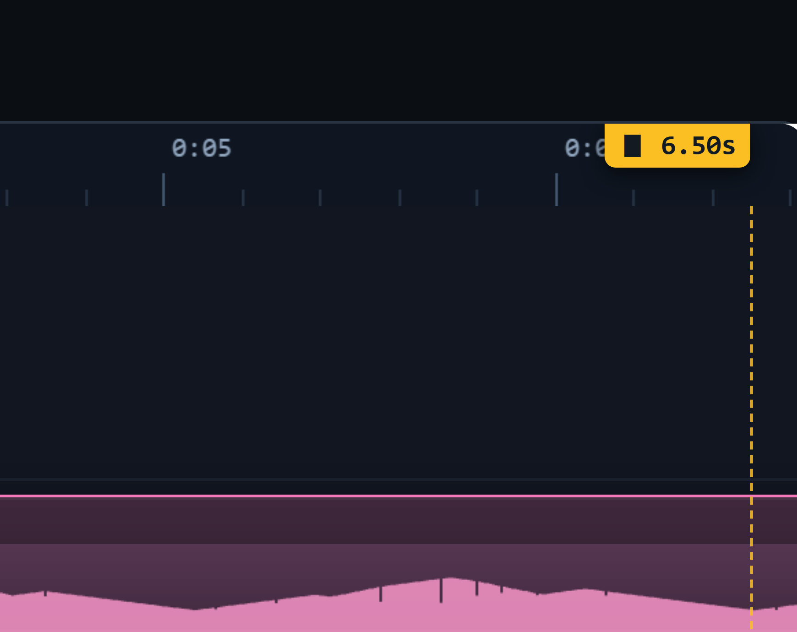
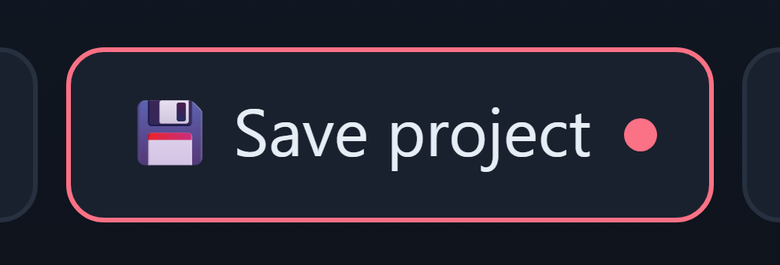

# Audiomix — drag & drop multitrack mixer

A tiny browser app for stacking audio files on a timeline, cutting and moving them around,
playing the result back, and getting it out again. No build step, no dependencies, no
install — plain HTML, CSS and vanilla JavaScript using the Web Audio API.

Created with **qwen3.8-flash-next-iq3_s**.



## Run it

Open `index.html` in a Chrome, Edge, Firefox or Safari window — double-clicking the file
works, the app runs from `file://` (plain classic scripts, no ES-module CORS problem).

Or serve the folder if you prefer http:

```sh
python -m http.server 8080      # then open http://localhost:8080
npx serve .
```

Audio formats are whatever your browser can decode through `decodeAudioData` — in practice
`.wav`, `.mp3`, `.ogg`, `.flac` and (Chrome/Edge/Safari) `.m4a`/`.aac`.

## What it does

| Need | How |
| --- | --- |
| Accept drag & drop audio files | Drop files anywhere on the app; each file becomes its own track, placed at the playhead. A toast reports what was added. |
| Place tracks on a timeline | One lane per track, with a name, colour, mute/solo, and a per-track gain. Waveforms are drawn from fixed-resolution peak buckets, so they stay correct at any zoom. |
| Move tracks on the timeline | Drag a clip sideways to reposition it (it snaps to 0, the playhead and other clip edges). Drag it vertically onto another lane to move it there. Reorder whole lanes with ▲▼, or type an exact start time in the inspector. |
| Split tracks into parts | Put the playhead where you want the cut, select a clip, press **Split** (`S`). The split is non-destructive — both parts keep pointing at the original file with the right source offsets, so nothing changes audibly. Trim a part by dragging its left or right edge. |
| Remove tracks / parts | Select a clip → **Delete** / `Del` / the ✕ on the clip. Select a lane header → **Remove track** / **Clear clips**. |
| Play back the mixed audio | Play / Pause / Stop, scrub by dragging the ruler, live output meter. Mute, solo, track gain, clip gain, master gain, and per-clip fade in/out all apply in real time. |
| Save the result | **Export WAV** renders the whole mix offline to a 16-bit PCM WAV at your device's sample rate, saved as `audiomix-mix-<stamp>.wav`. **Save project** writes a JSON session (`audiomix-project-<stamp>.json`) with the original audio embedded, and **Load project** puts everything back exactly as it was. |
| Set a total length / end line | Inspector → **Project length**. Type an exact end in seconds (`step="0.01"`, so 0.01 s precision), or press **▮ End at playhead** / **▮ End at last clip**, or drag the ▮ marker on the ruler, or press `E` (`Shift+E` removes it). The value is stored rounded to 0.01 s and draws a dashed amber line across the timeline. |
| Don't lose the mix by closing the tab | Closing **or reloading** asks you to confirm while there are unsaved changes. Until you save, the **Save project** button shows a red dot and the status bar says `· unsaved changes`. |

### What the end line does

It is the project's total length: playback stops there, and the offline export is
*exactly* that long — no padding, no tail. Set it **before** the last clip to cut the mix
short (clips past it stay on the timeline, visible but silent, and are not exported), or
**past** the last clip to end on a fixed-length silent tail. Leaving the field empty (or
pressing **✕ Follow last clip** / `Shift+E`) means "auto": the length follows the last clip,
and the export keeps a small 0.15 s tail so a trailing fade is never clipped. The status bar
shows both — `0:06.5 total · ▮ end line 6.50s (-1.00s cut)` — so it is always clear which
rule is in force. Rounding is `Math.round(t * 100) / 100`; the smallest value is 0.01 s.



### Closing or reloading the tab

The confirm dialog is wired to a real answer to "would closing throw work away?", not a
blanket nag. [js/model.js](js/model.js) keeps a small fingerprint of the mix — track and
clip geometry, gains, mutes, names, master gain, the end line, which audio is loaded; not
the audio bytes — and compares it with the fingerprint taken when the project was last
**saved** or **loaded**, or at boot (`markProjectSaved`). Only when the two differ and
there is something on the timeline does the `beforeunload` handler call `preventDefault()`
and let the browser show its leave-page prompt; an empty or freshly saved project closes
quietly, and `markProjectSaved()` runs right after a save or load so the guard goes away
immediately.

The same check paints the warning *before* it bites: a red dot on **Save project** and
`· unsaved changes` in the status bar.



Chrome, Edge and Firefox ignore custom dialog text and substitute their own wording ("Changes
you made may not be saved"), and headless Chrome — which drives the test suite — suppresses
the prompt altogether. The tests therefore assert the decision (the prompt is requested while
dirty, not after saving, and both indicators follow) rather than the pixels of a dialog.

### Keyboard

`Space` play/pause · `S` split at playhead · `E` set the end line at the playhead,
`Shift+E` remove it · `Del` / `Backspace` remove the selected clip ·
`←` `→` move the playhead (hold `Shift` for 1 s) · `Home` / `End` jump · `+` `-` zoom,
`0` zoom to fit · `Esc` deselect. `Ctrl` + mouse wheel also zooms.

Zoom ranges from 6 to 2400 pixels per second; **Fit** frames the whole project — the last
clip, or the end line if one is set.

## Project file

`Save project` produces JSON that is self-contained — audio bytes are stored as base64, so
a project reopens on another machine without the original files:

```jsonc
{
  "app": "audiomix",
  "version": 1,
  "masterGain": 0.9,
  "end": 0,
  "ppp": 80,
  "buffers": [ { "id": "b1", "name": "drum-loop.wav", "b64": "UklGRkg..." } ],
  "tracks": [
    {
      "id": "t1", "name": "drum-loop", "color": "#38bdf8",
      "gain": 1, "muted": false, "solo": false,
      "clips": [
        { "id": "c1", "bufferId": "b1", "name": "drum-loop.wav",
          "start": 0, "offset": 0, "duration": 2.5,
          "gain": 1, "fadeIn": 0, "fadeOut": 0 }
      ]
    }
  ]
}
```

`Load project` validates that shape (`validateProject` in [js/model.js](js/model.js)) and
reports which check failed instead of half-applying a broken file. `end` is optional: absent
or `0` means "follow the last clip"; any other value must be a positive number and is
restored at 0.01 s resolution.

## Code layout

```
index.html      app shell: transport bar, timeline, inspector, drop veil
styles.css      dark DAW styling, sticky lane headers and ruler
js/model.js     pure timeline state: tracks, clips, split, end line, serialize, validate — no DOM, no audio
js/audio.js     AudioContext graph, decode, playbacks, offline mixdown, WAV encoder, peaks
js/ui.js        rendering + pointer/keyboard interaction: ruler, lanes, drags, snapping, inspector
js/app.js       glue: drop handling, add files, save/load project, export
```

The split between `model.js` and `ui.js` is deliberate — the model is plain data plus a few
pure functions, which is what makes the browser test below able to assert on real
behaviour instead of pixels.

Coordinate contract, since it's the part that breaks first when editing the UI: clips are
positioned inside their `.lane` (`left = timeToX(t)`), while `.playhead`, `.end-line` and
`.snap-guide` are children of `#lanes` and therefore need `HEADER_W + timeToX(t)`; the
ruler's playhead marker and the draggable `.end-marker` live inside `.ruler-wrap` and use
plain `timeToX(t)`. The end marker flips its label to the left of the line when it would be
clipped by the right edge.

Anything asking "how long is this project?" must go through `projectEnd()`, never
`computeDuration()` directly: layout width, zoom-to-fit, the playhead clamp, the transport
readout, playback stop, and the offline render length all follow the end line, while
`computeDuration()` stays the length of the audio actually on the timeline (used for the
"last clip" readout and as a snapping target).

## Tests

A real headless-browser integration test (raw DevTools Protocol, no test framework):

```sh
node test/run-smoke.mjs
```

It launches Chrome/Edge, loads `index.html` over `file://`, synthesises three WAV files,
drives the app through the whole workflow — including real pointer drags, real keyboard
events, and real Web Audio playback and rendering — and prints a verdict:

```
RESULT 34/34 checks passed
```

Those checks cover: drop-to-add, clip rendering, split geometry and source offsets,
part removal, dragging a clip (with the DOM agreeing with the model), dragging between
lanes, both trim directions, split being audibly identical, the Split button and its
disabled state, offline-mix length, mute/solo changing the render, a valid 16-bit stereo
WAV header, playback advancing on the AudioContext clock, Play/Pause/Stop buttons,
dropping onto an existing lane, Delete, track removal, lane reordering, keyboard
shortcuts, project round-trip equality, the empty state, zoom, and the end line: 0.01 s
rounding, an exact-length truncated export whose audio before the cut is bit-identical to
the uncut mix, a silent tail when the line sits past the last clip, playback halting on the
line, setting it from the field / button / `E` key, the marker and status badge appearing and
disappearing, dragging the ▮ handle on the ruler (including its label flipping to stay
inside the view), and saving, reloading and rejecting `end`.

The run also prints `CLOSE_DIALOG_PROBE {…}`: it reloads a dirty page over CDP and reports
whether a native prompt was raised. Headless Chrome answers it silently, so that line is
informational; the assertion above is about our `preventDefault` decision.

`node test/screenshot.mjs` writes the images in `test/shots/` from the same driven session,
used for visual review — including `06-end-line.png`, `07-end-line-flag.png` (the ruler
marker cutting a waveform), `08-end-line-inspector.png` (the Project length panel),
`09-unsaved-indicator.png` and `10-unsaved-status.png` (the unsaved-work signals).

If your sandbox blocks spawning Chrome or writing to the system temp dir, use a
workspace-local profile (the scripts already do) and allow the command to run with wider
file access. Set `CHROME` to point at a different browser binary.

## Known limits

Deliberately out of scope for a tool this size: undo/redo, time-stretching, effects and
routing beyond per-track gain, stereo interleaved-file channel splitting, and
auto-saving. Dragging a clip onto an occupied spot does not ripple other clips out of the
way — overlap mixes as-is, which is what a mixer does.
